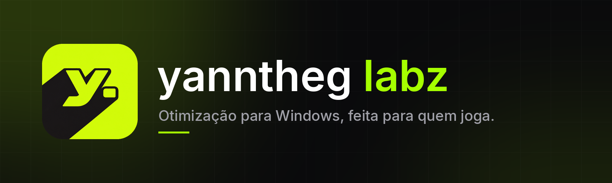

  

  

  
  
  
  

---

## O que é

O **yanntheg labz** é um aplicativo para Windows que reúne, num só lugar, os ajustes que deixam o PC mais limpo, leve e pronto para jogar. É um arquivo único, sem instalador, e cada mudança que ele faz pode ser desfeita.

## Destaques

| | |
|---|---|
| **Ajustes com volta garantida** | Mais de 40 ajustes do Windows. Antes de mexer, o app guarda o valor original, e **Restaurar originais** devolve exatamente o que havia. |
| **Overlay de FPS** | FPS, tempo de quadro, 1% low, CPU, GPU e RAM por cima do jogo, sem injetar nada nele. Liga e desliga com `Ctrl + Shift + F`, mesmo com o jogo já aberto. |
| **Perfis por jogo** | Aponte o `.exe` do jogo, e o botão **JOGAR** aplica o perfil, abre o jogo e desfaz o que era temporário quando ele fecha. |
| **Modo Competitive** | Um botão que liga um conjunto seguro de ajustes de latência, processos e estabilidade. Atalho: `Ctrl + Shift + C`. |
| **Favoritos e Recomendados** | Marque com ★ os ajustes que mais usa, e veja numa aba só o que o app recomenda e ainda falta aplicar. |
| **Leve de verdade** | Modo leve, memória liberada em segundo plano e início com o Windows opcional (escondido na bandeja). |
| **Atualização automática** | O app avisa de versões novas e se atualiza sozinho. |

## O que mais tem dentro

- **Manutenção:** limpeza de temporários, cache de miniaturas e DNS, SFC, DISM.
- **Diagnóstico inteligente:** observa o PC por 15 segundos e aponta gargalos de CPU, GPU, RAM e VRAM.
- **Sensores e Benchmark:** temperaturas, clocks e consumo, mais testes de CPU, memória e disco para comparar antes e depois.
- **Rede:** ping, jitter e perda de pacotes, com troca de DNS e volta ao original.
- **Debloat e Serviços:** remove apps pré-instalados de uma lista segura e desativa serviços pouco usados, com backup.
- **Gaming Session:** grava FPS, 1% low e temperaturas durante o jogo e guarda um relatório.
- **Restaurar tudo:** desfaz de uma vez o que o app mudou, com ponto de restauração opcional antes.

## Segurança

- Nada aqui desativa Defender, Firewall, UAC, Windows Update nem a isolação de núcleo.
- O app não altera configurações dentro do driver de vídeo.
- Tudo o que muda fica registrado, e quase tudo tem **Prévia** antes de aplicar e **Desfazer** depois.

## Como usar

1. Baixe o **yannthegLabz.exe** pelo botão no topo desta página.
2. Dê dois cliques. O app pede permissão de administrador, porque mexe em configurações do sistema.
3. Comece pela aba **Recomendados**: ela mostra o que falta aplicar, e você escolhe.

> **Aviso do Windows:** como o arquivo ainda não tem assinatura digital, o SmartScreen pode mostrar "o Windows protegeu o computador". Clique em **Mais informações** e depois em **Executar assim mesmo**.

**Requisitos:** Windows 10 ou 11, 64 bits. Não precisa instalar o .NET.

## Atualizações

O app confere sozinho se existe versão nova ao abrir (dá para desligar em **Configurações**). Também dá para verificar à mão em **Configurações → Atualizações**.

## Resultados

Cada PC é diferente, e o ganho depende do hardware e do que já estava instalado. O app mostra o que mudou e deixa você medir antes e depois, com o Benchmark e o Overlay de FPS.

---

   
  feito por <b>@yanntheg</b>

